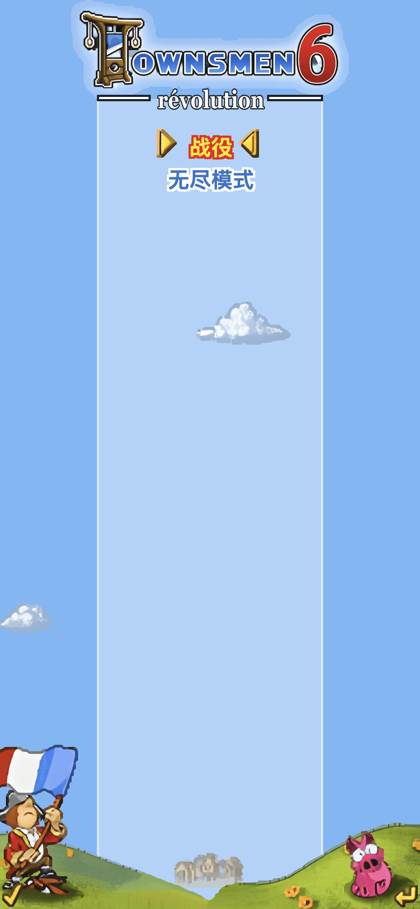
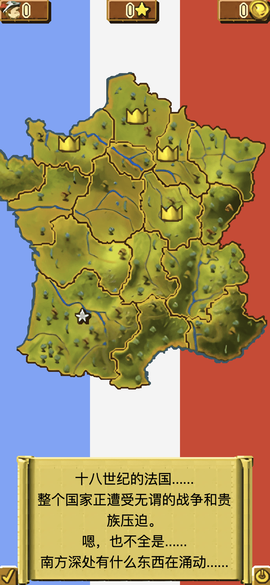
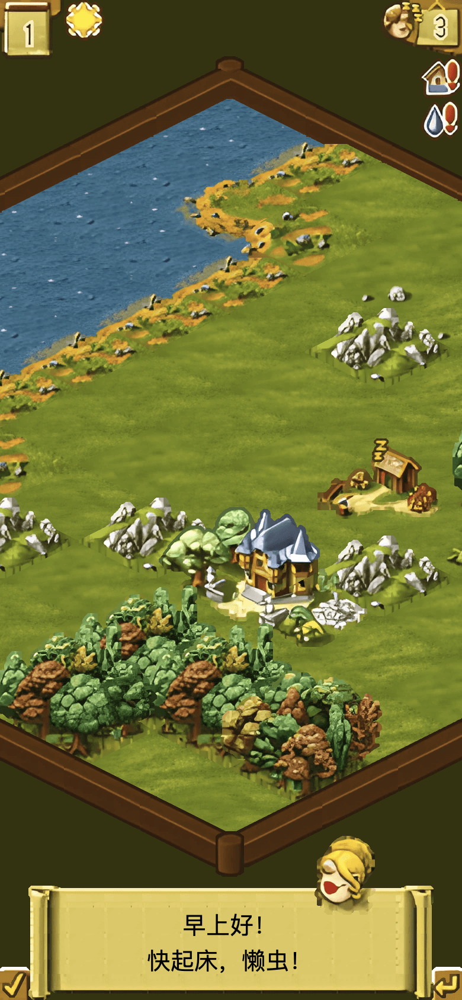
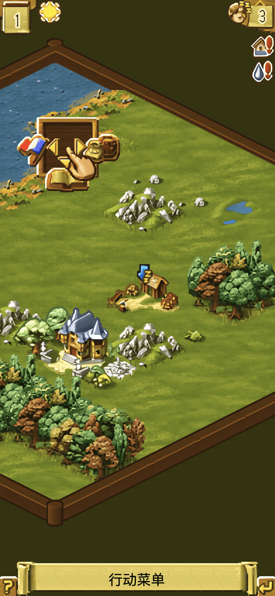

# 镇民 6

《Townsmen 6: Revolution》的网页版，手机浏览器里就能玩。时间在十八世纪的法国：从一片海岸空地建起小镇，伐木、种麦、捕鱼、烤面包，把镇民安顿好，再训练士兵和宣传员，把国王占着的地盘夺过来。

界面是简体中文。点一下是查看，再点一次是确定，拖动可以移动视野。进度保存在本机。

网页试玩：https://liuzhuoling2011.github.io/townsmen6/

## 画面

下面是 iPhone 竖屏（390×844）上的实机画面。

<p align="center">
  
  
  
  
</p>

<p align="center">主菜单 · 法国战役 · 海边定居点 · 行动菜单</p>

## 本地运行

```bash
cd web
npm install
npm run dev
```
